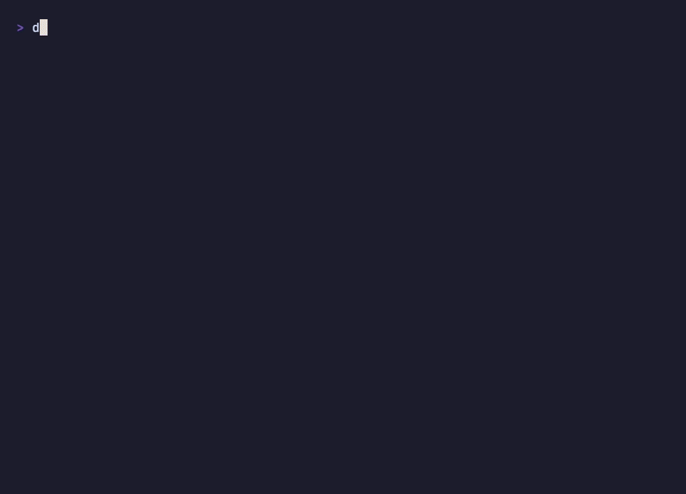

# Dracosh

A gamified language or definitions trainer for your terminal. It sits in a spare pane, challenges you every few minutes, and a small pixel dragon grows up as you keep your streak going.



## Why Dracosh

Learning a language usually means another hour in the evening, after a full day at the computer. I spent plenty of those evenings myself, and I wanted something that fits into the working day instead.

The day is full of short waits: a build that takes a minute, tests running, an AI agent finishing a task for you. Dracosh turns those moments into practice. Instead of reaching for your phone, you answer a word or two, the dragon cheers, and you're back to work. A few minutes here and there add up, and your evenings stay yours.

It's made for people who live in a terminal or spend most of the day at a computer, and it's meant to be fun, not one more chore.

## Features

- Your cards live in Dracosh's own library, organised in decks; no other app needs to be running
- Add cards, start decks and switch between them right in the app (`/add`, `/decks`)
- One line is a card: `el gato = the cat; the kitty // Mi gato duerme.` (`;` separates right answers, `//` adds an example). Paste a whole list, or rows copied from a spreadsheet, and check it before it's saved
- Import cards from Anki and Quizlet exports, a spreadsheet's CSV or a plain text list, and export them as an Anki deck package, for a spreadsheet or as a text file you can edit (or have an AI assistant write); you see what changes before anything is saved
- Each deck is asked the way you pick after its first card: front → back, back → front, or both ways; change it any time in `/decks`
- Pronunciation, if you turn it on in `/settings`: once the answer is out, the word in the language you're learning in that deck is read aloud with a macOS voice (other systems later); decks in one language, like definitions, stay quiet
- Dracosh works out which languages a deck is in (Spanish → English, say) and which of the two you're learning, from the cards, the deck's name and your other decks, whatever language you use Dracosh in, and says when it's only a guess; set either in `/decks` when it can't tell or guesses wrong
- Type the answer, or press Enter with nothing typed to see it and say whether you knew it (`1` or `2`): handy for whole sentences, and it counts just the same
- Cloze cards for sentences: `I {{look forward}} to it` asks one gap at a time
- Forgiving answer checks: case and punctuation don't matter, a missing accent or special letter (ż, ł, é, ø…, and ß written as ss) still counts and the right spelling is shown with it marked, German "Baer" for "Bär" and Danish "aa" for "å" count too, an article can be left out in English ("cat" for "the cat"), while a missing or wrong article where it carries the gender ("Hund" for "der Hund") or a German umlaut left plain ("Bar" for "Bär") counts as almost: right, but the card stays at its level, one typo is fine on longer words, and after a miss you see letter by letter where you went wrong. Chinese, Japanese and Korean answers are checked exactly
- Leitner boxes, so the cards you know come back less and less often; a card is only asked when it's due, and can be done any time on that day; up to 20 new cards a day, and the rest are said to be waiting for tomorrow
- Daily goal, streaks (weekends, days off and days with nothing to practise don't break them) and 36 badges (one of them a secret)
- A pixel dragon that hatches from an egg, evolves over a year of streaks, blinks, and falls asleep if you ignore it
- 8-bit sound effects, generated from code
- Now and then, a short tip about Dracosh while you wait for the next card
- Speaks English, Polish, German, French and Ukrainian: it follows your system's language, and `/settings` switches it

## Install

You need Node 22.13 or newer.

```bash
npm install -g dracosh
```

A fresh install starts with a short "Getting started" deck, in the app's language: a tour where every card tells you what to type and shows you one more thing Dracosh can do. When you're through, `/add` starts your own deck and the tour makes room for it. Already have cards somewhere else? See [Import and export](#import-and-export).

Want a look first? `dracosh --preview` shows every screen and animation on made-up data.

## Usage

```bash
dracosh --deck "Spanish"   # quiz this deck, this run only (otherwise the one picked in /decks)
dracosh --every 5m         # a card every 5 minutes instead of 10, this run only
dracosh --no-sound
dracosh --stats            # print your progress and exit
dracosh --data             # show where your cards, progress and backups are kept
dracosh --preview
dracosh restore            # list your backups; dracosh restore 2 brings one back
dracosh import words.csv   # add cards from a file, see Import and export below
dracosh export spanish.txt --deck "Spanish"
```

Type the answer and press Enter. Not sure, or the answer is a whole sentence? Press Enter with nothing typed: the answer shows up, then press `1` if you didn't know it or `2` if you did. Press `/` for commands:

| Command | What it does |
| --- | --- |
| `/add` | add cards to one of your decks, or start a new deck (one line per card, ↑ fixes the last one) |
| `/decks` | switch to another deck (Dracosh remembers it), start a new one, or press → to change how a deck is asked and which languages it's in |
| `/hint` | reveal one more letter |
| `/correct` | your answer was right after all; after a yes it's accepted from now on |
| `/settings` | language, rhythm (a card every few minutes, or a study session), interval, daily goal, sound, pronunciation, quiet hours, weekends, tips, and a reset |
| `/stats` | streak and a calendar of your month |
| `/badges` | all badges and how to get them |
| `/companion` | your dragon, its element and the forms ahead |
| `/missed` | cards you got wrong today |
| `/pause 30m` | a break: `30m`, `2h`; or days off that keep your streak: `3d`, `24.12 2.01`; `off` ends it |
| `/help` | the keys, how cards come back, the streak |
| `/quit` | quit (you'll get a short session summary) |

They're slash commands because "pause" and "quit" are perfectly good English answers.

## Import and export

```bash
dracosh import words.txt            # Dracosh lines, see below
dracosh import anki-export.txt      # Anki: File → Export → Notes in Plain Text
dracosh import quizlet.txt          # Quizlet: Export, tab between term and definition
dracosh import vocabulary.csv       # a spreadsheet (Excel's semicolons work too)
dracosh import words.csv --deck "Spanish"
```

An import reads the file, then shows what it found before anything is saved: how it split the columns, which deck the cards go into, the new cards, the ones already there, and every line it can't use, with its line number. Cards already in the deck with other answers are listed as they are now and as the file has them, and you decide whether they're updated (their progress stays). Answers listed the way Anki and Quizlet decks often have them ("cat, kitty") can be taken as separate answers. A new deck asks which way to quiz, as in `/add`, and the last question says exactly what will be added and updated. When you already have cards, a backup is taken first, so `dracosh restore 1` undoes an import. Outside a terminal nothing is written without `--yes`: the preview ends with the command that imports for real. For scripts, `--update` takes the file's version of cards already there and `--split` splits listed answers.

A header row (`front,back,example`, `term;definition`) is used to pick the columns, in any order. A file that isn't UTF-8 is never guessed at: Dracosh shows its first line read each likely way and asks for `--encoding`.

| Export | What you get |
| --- | --- |
| `dracosh export spanish.apkg` | for Anki: open it (double-click, or File → Import) and the decks are there, in an Anki set up in any language. It brings two note types of its own, Dracosh and Dracosh Cloze, with the example in a field of its own and a card for each way the deck asks. Export again after changing cards and Anki updates the same notes instead of adding them twice. Progress isn't carried over: the cards start as new |
| `dracosh export spanish.txt` | Dracosh lines: easy to read and edit, and `dracosh import` reads them back unchanged |
| `dracosh export spanish.tsv` | Anki's plain text, for other apps or when you want Anki's own note types: File → Import; cloze cards go into `spanish-cloze.tsv` next to it, as Anki keeps the two note types apart. If your Anki isn't in English, pick its Basic and Cloze note types in the import dialog |
| `dracosh export spanish.csv` | for a spreadsheet: front, back, example (and deck) |
| `dracosh export everything.json` | all your cards, progress and settings; `dracosh import everything.json` brings them back, on another computer too |

Add `--deck "Spanish"` for one deck; without it you get all of them. `.txt`, `.json` and `.apkg` keep how each deck asks; a `.csv` or `.tsv` holds just the cards. An export never writes into Dracosh's own folder.

### The Dracosh text format

The same line as in `/add`, one card per line:

```text
# lines starting with # are comments
#deck:Spanish
#direction:forward
el gato = the cat; the kitty // Mi gato duerme.
la casa = the house
Me {{gusta}} el café. = I like coffee
```

`;` separates right answers, `//` starts an example, and `{{ }}` makes a gap to fill in; a card with gaps needs nothing after `=`, and what's there is a hint shown with the gap. `#deck:` puts the cards below it into that deck (it can come again for the next one), and `#direction:` under it says how a new deck asks: `forward`, `backward` or `both`. To use one of these characters as plain text, put a backslash before it: `\=`, `\;`, `\//`, `\{{`, and `\#` at the start of a line.

### Write a deck with your AI assistant

An AI coding assistant (Claude Code, Codex and the like) can write such a file from your notes, a textbook chapter or a word list, no API key needed. A prompt to start from:

```text
Make a Dracosh deck from <your notes, a topic, a list of words>.
Write it to cards.txt in this format, one card per line:
  front = answer; another accepted answer // an example sentence
Start the file with #deck:<deck name, with the language in it> and #direction:both.
Put the language I'm learning before =, nouns with their article: der Löffel = the spoon
Keep answers short: no notes in brackets, no plurals; extra information goes after //.
For a sentence, put {{ }} around one part to fill in; after = comes a hint, not answers:
  Me {{gusta}} el café. = I like coffee
Plain text only: no markdown, numbering or bullets.
Then run `dracosh import cards.txt`: it changes nothing yet, it shows how it read the file.
Fix the lines it lists, and tell me the command to import it for real.
```

## Your data

Everything stays on your machine, in `~/.dracosh`; `dracosh --data` shows what's there. Progress is saved after every answer, so you can quit any time. One quiz runs at a time: a second window on the same data is refused, so the two can't overwrite each other's progress. The first start of each day also saves a backup of your cards, progress and settings to `~/.dracosh/backups` (the last 7 are kept); `dracosh restore` brings one back, and backs up what you have first, so a restore can be undone too. To start over, `/settings` → Reset clears your progress only (badges, streak, the dragon) or everything; a backup is made first. To move to another computer, `dracosh export everything.json` there and `dracosh import everything.json` here; to use Dracosh on two computers at once, put that folder somewhere synced and point `DRACOSH_HOME` at it.

Sounds currently play on macOS only.

## Development

```bash
git clone https://github.com/lynthius/dracosh.git
cd dracosh
npm install
npm link          # puts `dracosh` on your PATH
npm test
```

The quiz logic in `src/session.js` and `src/progress.js` does no I/O, which keeps it easy to test. The UI is built with [Ink](https://github.com/vadimdemedes/ink) and lives in `src/ui/`; every text it shows is in `locales/en.json`, read through `t("key")` from `src/i18n.js`.

The other languages live next to it in `locales/`, the tour included. `npm test` checks that each one has every English key, the same `{placeholders}` and all the plural forms its language needs. If you're a native speaker and something reads oddly, a pull request is very welcome. Sound effects are generated by `scripts/make-sounds.js` (`npm run sounds`). The demo at the top is recorded with [VHS](https://github.com/charmbracelet/vhs): `vhs docs/demo/demo.tape` writes `docs/demo.gif` from a throwaway deck in `/tmp`.

## What's next

Coming next, roughly in this order:

- More imports: `.apkg` decks shared on AnkiWeb, and a copy straight from a running Anki.
- Decks and cards in the app: browse, edit and delete with undo, plus a welcome flow for new users.
- Optional AI help for writing cards, with your own API key or a local model.
- Linux and Windows, pronunciation there included.

## License

The code is licensed under [Apache 2.0](LICENSE), so feel free to use it, change it and build on it. The name "Dracosh" and the dragon mascot aren't covered by the license, so forks need their own name. See [NOTICE](NOTICE).

Contributions are welcome!
